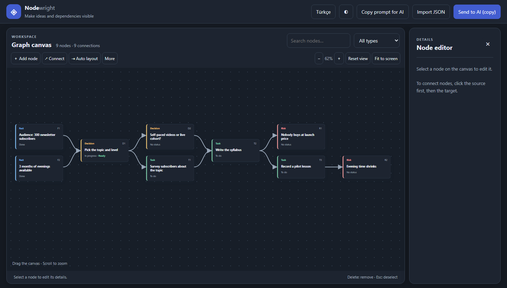

# Nodewright

**English** · [Türkçe](README.tr.md)

**Turn a messy problem into a graph that you and your AI agent can both read, edit and reason about.**

Nodewright is a single-page canvas for thinking in dependencies. You describe a project, decision or automation idea to an AI agent. The agent answers with a small JSON graph of **facts, decisions, tasks and risks** and the links between them. You paste that graph into Nodewright, see it, rearrange it, mark what is done, add notes, budgets and risk levels, and copy the updated graph back to the agent so it can re-plan with real information.

No build step. No dependencies. No server. Everything runs in your browser.



The interface comes in **English and Turkish**. It starts in your browser's language and you can switch with the button in the top right (your choice is remembered).

## The loop

```
   you ──(describe a problem)──▶ agent + graph skill
                                      │
                         JSON graph (nodes + edges)
                                      ▼
                  Nodewright: see it, edit it, track status
                                      │
                      copy the updated graph back
                                      ▼
   agent explains what changed, where the bottleneck is, what to decide next
```

1. Tell your agent: *"Use the `graph-problem-solver` skill and map out my problem: …"* (see [the skill](#the-skill)).
2. The agent replies with a `json` code block.
3. In Nodewright click **Import JSON** and paste the *whole* reply. Nodewright finds the JSON inside the text, validates it and shows readable errors if something is wrong.
4. Work on the canvas: drag nodes, connect them, set status, add notes.
5. Click **Send to AI (copy)** and paste the updated graph back to the agent.

If your agent does not have the skill installed, click **Copy prompt for AI**: it copies a ready-made prompt with the schema and your current graph.

## Features

- Four node types: `fact`, `decision`, `task`, `risk`; edges mean "depends on / leads to".
- Status per node: `todo`, `doing`, `done`. A node shows a **Ready** badge when every node it depends on is `done`.
- Per-node notes, budget and risk level (`low`, `medium`, `high`, `critical`).
- Select a node to highlight its whole upstream and downstream chain and dim the rest.
- Automatic layout by dependency order, with cycle detection.
- Search and filter by node type.
- Pan, zoom (wheel), fit to screen, light and dark theme.
- English and Turkish interface (the copied AI prompt follows the interface language).
- Autosave in your browser's `localStorage`; JSON import and download.
- Extra fields in your JSON are preserved, so an agent can attach its own metadata.
- Keyboard: `Delete` removes the selection, `Esc` clears it.

## Run it

Open `index.html` in any modern browser. That is all.

If you prefer a local server: `python -m http.server` in this folder, then open `http://localhost:8000`.

Try the bundled example: **More → Sample graph** loads a tiny sample, or import [`examples/launch-an-online-course.json`](examples/launch-an-online-course.json).

## Graph format

```json
{
  "nodes": [
    { "id": "F1", "label": "Verified fact",   "type": "fact",     "x": 100, "y": 100 },
    { "id": "D1", "label": "Decision to make", "type": "decision", "x": 380, "y": 100 },
    { "id": "T1", "label": "Next task",        "type": "task",     "x": 660, "y": 100, "status": "todo" },
    { "id": "R1", "label": "Important risk",   "type": "risk",     "x": 660, "y": 260, "riskLevel": "high" }
  ],
  "edges": [
    { "from": "F1", "to": "D1" },
    { "from": "D1", "to": "T1" },
    { "from": "D1", "to": "R1" }
  ]
}
```

| Field | Required | Values |
|---|---|---|
| `nodes[].id` | yes | unique, non-empty string |
| `nodes[].label` | yes | string |
| `nodes[].type` | yes | `fact`, `decision`, `task`, `risk` |
| `nodes[].status` | no | `todo`, `doing`, `done` |
| `nodes[].x`, `nodes[].y` | no | finite numbers; missing positions are filled in automatically |
| `nodes[].notes`, `budget`, `riskLevel` | no | free text, number, `low`/`medium`/`high`/`critical` |
| `edges[].from`, `edges[].to` | yes | ids of existing nodes |

## The skill

The [`skills/`](skills) folder contains the `graph-problem-solver` agent skill that teaches an agent to produce and update graphs in this format, to keep verified facts separate from assumptions, and to continue the conversation when you send an edited graph back.

- English: [`skills/en/graph-problem-solver/SKILL.md`](skills/en/graph-problem-solver/SKILL.md)
- Turkish (original): [`skills/tr/graph-problem-solver/SKILL.md`](skills/tr/graph-problem-solver/SKILL.md)

Install **one** of them by copying its folder into your agent's skills directory, for example `~/.claude/skills/` for Claude Code or `~/.codex/skills/` for Codex CLI.

## Privacy

Nodewright makes no network requests. Your graph lives in your browser's `localStorage` and in the JSON you copy or download yourself.

## Adding a language

All interface text lives in [`i18n.js`](i18n.js). Copy the `en` object, translate the values, add it to the returned object and to `LANGS`, and the language button will cycle through it (the button currently toggles between two languages, so for a third one change the `lang` click handler in `app.js` to cycle through `LANGS`).

## Project layout

```
index.html   the page
app.js       all behaviour (vanilla JavaScript, one file)
i18n.js      interface texts (English, Turkish)
styles.css   styling (light and dark)
examples/    sample graphs
skills/      the agent skill (English and Turkish)
docs/        screenshot
```

## License

MIT, see [LICENSE](LICENSE).
