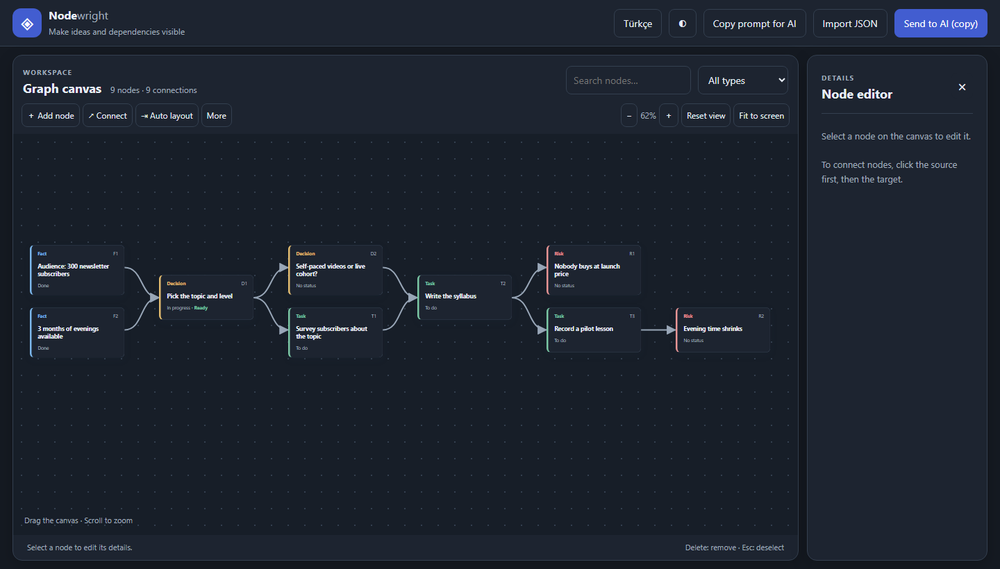

# Nodewright

[English](README.md) · **Türkçe**

**Dağınık bir problemi, sizin ve yapay zekâ ajanınızın birlikte okuyup düzenleyebildiği bir grafa dönüştürün.**

Nodewright, bağımlılıklar üzerinden düşünmek için tek sayfalık bir tuvaldir. Bir projeyi, kararı ya da otomasyon fikrini yapay zekâ ajanına anlatırsınız. Ajan size **gerçekler, kararlar, görevler ve riskler** ile aralarındaki bağlantılardan oluşan küçük bir JSON grafı verir. Bu grafı Nodewright'a yapıştırırsınız; görürsünüz, yerlerini değiştirirsiniz, bitenleri işaretlersiniz, not, bütçe ve risk seviyesi eklersiniz. Güncel grafı ajana geri kopyalarsınız ve ajan gerçek bilgiyle yeniden plan yapar.

Derleme adımı yok. Bağımlılık yok. Sunucu yok. Her şey tarayıcınızda çalışır.



Arayüz **İngilizce ve Türkçe** gelir. Tarayıcınızın diliyle açılır; sağ üstteki düğmeyle değiştirebilirsiniz (seçiminiz hatırlanır). Ekran görüntüsü İngilizce arayüzü gösterir.

## Döngü

```
   siz ──(problemi anlatın)──▶ ajan + graf skill'i
                                      │
                         JSON graf (düğümler + bağlantılar)
                                      ▼
                  Nodewright: görün, düzenleyin, durumu izleyin
                                      │
                      güncel grafı ajana geri kopyalayın
                                      ▼
   ajan neyin değiştiğini, darboğazın nerede olduğunu, sıradaki kararı söyler
```

1. Ajanınıza şunu söyleyin: *"`graph-problem-solver` skill'ini kullan ve problemimi haritala: …"* ([skill](#skill) bölümüne bakın).
2. Ajan bir `json` kod bloğuyla yanıt verir.
3. Nodewright'ta **JSON içe aktar** düğmesine basın ve yanıtın *tamamını* yapıştırın. Nodewright JSON'u metnin içinden bulur, doğrular ve sorun varsa anlaşılır hatalar gösterir.
4. Tuvalde çalışın: düğümleri sürükleyin, bağlayın, durum verin, not ekleyin.
5. **AI'ya gönder (kopyala)** düğmesine basın ve güncel grafı ajana yapıştırın.

Ajanınızda skill kurulu değilse **AI için istemi kopyala** düğmesine basın: şema ve mevcut grafınızla birlikte hazır bir istem kopyalanır.

## Özellikler

- Dört düğüm türü: `fact` (gerçek), `decision` (karar), `task` (görev), `risk`; bağlantı "buna bağlıdır / buna götürür" demektir.
- Düğüm başına durum: `todo`, `doing`, `done`. Bağlı olduğu tüm düğümler `done` olunca düğümde **Hazır** rozeti çıkar.
- Düğüm başına not, bütçe ve risk seviyesi (`low`, `medium`, `high`, `critical`).
- Bir düğümü seçince onun öncül ve ardıl zincirinin tamamı vurgulanır, gerisi soluklaşır.
- Bağımlılık sırasına göre otomatik yerleşim; döngü algılama.
- Arama ve türe göre süzme.
- Kaydırma, tekerlekle yakınlaştırma, ekrana sığdırma, açık ve koyu tema.
- İngilizce ve Türkçe arayüz (kopyalanan AI istemi de arayüz diline uyar).
- Tarayıcının `localStorage` alanında otomatik kayıt; JSON içe aktarma ve indirme.
- JSON'daki ek alanlar korunur; ajan kendi üst verisini ekleyebilir.
- Klavye: `Delete` seçileni siler, `Esc` seçimi kaldırır.

## Çalıştırma

`index.html` dosyasını herhangi bir güncel tarayıcıda açın. Bu kadar.

Yerel sunucu isterseniz bu klasörde `python -m http.server` çalıştırıp `http://localhost:8000` adresini açın.

Hazır örneği deneyin: **Diğer → Örnek graf** küçük bir örnek yükler. Ya da [`examples/launch-an-online-course.json`](examples/launch-an-online-course.json) dosyasını içe aktarın (İngilizce bir online kurs örneği).

## Graf biçimi

```json
{
  "nodes": [
    { "id": "F1", "label": "Doğrulanmış gerçek", "type": "fact",     "x": 100, "y": 100 },
    { "id": "D1", "label": "Verilecek karar",    "type": "decision", "x": 380, "y": 100 },
    { "id": "T1", "label": "Sonraki iş",         "type": "task",     "x": 660, "y": 100, "status": "todo" },
    { "id": "R1", "label": "Önemli risk",        "type": "risk",     "x": 660, "y": 260, "riskLevel": "high" }
  ],
  "edges": [
    { "from": "F1", "to": "D1" },
    { "from": "D1", "to": "T1" },
    { "from": "D1", "to": "R1" }
  ]
}
```

| Alan | Zorunlu | Değerler |
|---|---|---|
| `nodes[].id` | evet | benzersiz, boş olmayan metin |
| `nodes[].label` | evet | metin |
| `nodes[].type` | evet | `fact`, `decision`, `task`, `risk` |
| `nodes[].status` | hayır | `todo`, `doing`, `done` |
| `nodes[].x`, `nodes[].y` | hayır | sonlu sayılar; eksik konumlar otomatik doldurulur |
| `nodes[].notes`, `budget`, `riskLevel` | hayır | serbest metin, sayı, `low`/`medium`/`high`/`critical` |
| `edges[].from`, `edges[].to` | evet | var olan düğümlerin kimlikleri |

Alan adları ve değerler (`fact`, `todo`, `high` …) arayüz Türkçe olsa da İngilizce kalır; böylece her ajan aynı biçimi üretir.

## Skill

[`skills/`](skills) klasörü, ajana bu biçimde graf üretmeyi ve güncellemeyi, doğrulanmış bilgiyle varsayımı ayrı tutmayı, düzenlenmiş grafı geri gönderdiğinizde sohbete devam etmeyi öğreten `graph-problem-solver` ajan skill'ini içerir.

- İngilizce: [`skills/en/graph-problem-solver/SKILL.md`](skills/en/graph-problem-solver/SKILL.md)
- Türkçe (özgün): [`skills/tr/graph-problem-solver/SKILL.md`](skills/tr/graph-problem-solver/SKILL.md)

İkisinden **birini** seçin ve klasörünü ajanınızın skill dizinine kopyalayın; örneğin Claude Code için `~/.claude/skills/`, Codex CLI için `~/.codex/skills/`.

## Gizlilik

Nodewright hiçbir ağ isteği yapmaz. Grafınız tarayıcınızın `localStorage` alanında ve sizin kopyaladığınız ya da indirdiğiniz JSON'da durur.

## Dil ekleme

Tüm arayüz metinleri [`i18n.js`](i18n.js) dosyasındadır. `en` nesnesini kopyalayın, değerleri çevirin, döndürülen nesneye ve `LANGS` listesine ekleyin. Dil düğmesi şu an iki dil arasında geçiş yapar; üçüncü dil için `app.js` içindeki `lang` tıklama işleyicisini `LANGS` üzerinde dönecek şekilde değiştirin.

## Proje yapısı

```
index.html   sayfa
app.js       tüm davranış (sade JavaScript, tek dosya)
i18n.js      arayüz metinleri (İngilizce, Türkçe)
styles.css   görünüm (açık ve koyu)
examples/    örnek graflar
skills/      ajan skill'i (İngilizce ve Türkçe)
docs/        ekran görüntüsü
```

## Lisans

MIT, bkz. [LICENSE](LICENSE).
